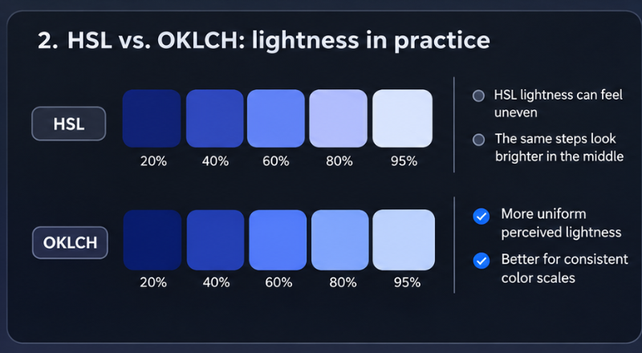
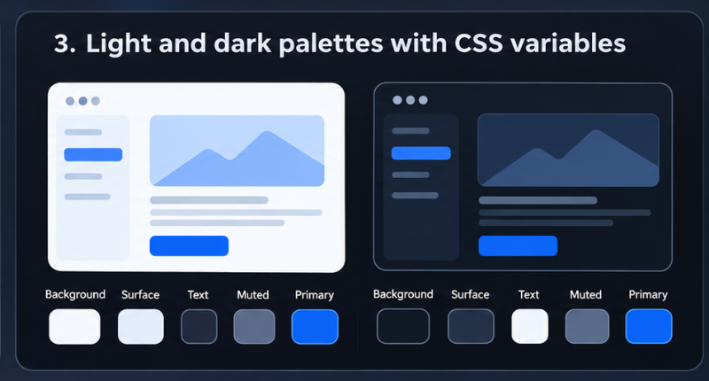

## Understanding Colors in CSS: From HEX Codes to OKLCH

You can spend years writing CSS without thinking much about the numbers behind its colors. Open a
color picker, find a shade that looks right, copy the HEX code, and move on.

That works until you need to make a color slightly warmer, create a consistent palette, or figure
out why two similar-looking colors have very different contrast.

Understanding how colors are represented makes those decisions easier.

Take `#3B82F6`. At first glance, it's just six hexadecimal characters. But those characters tell us
exactly how much red, green, and blue contribute to the color.

HEX is useful, but modern CSS offers much more. We can work with HSL, build perceptually oriented
palettes using OKLCH, mix colors directly in the browser, and derive shades from existing CSS
variables.

Let's start with the numbers.

## 1. Understanding HEX Colors

The familiar six-digit HEX notation is a compact way of expressing RGB channel values.

```
color: #3B82F6;
```

The code consists of three pairs: `3B` represents red, `82` represents green, and `F6` represents
blue.

Each pair is a hexadecimal number between `00` and `FF`.

Hexadecimal uses sixteen symbols: the digits 0–9 and the letters A–F. Each pair can represent 256
different values, from decimal 0 to 255.

| HEX | Decimal |
| --- | ------- |
| 00  | 0       |
| 40  | 64      |
| 80  | 128     |
| C0  | 192     |
| FF  | 255     |

With three channels, we get:

\\[ 256 \times 256 \times 256 = 16,777,216 \\]

That's more than 16 million RGB combinations.

### Breaking Down a HEX Color

HEX and RGB channels

Figure 1. A six-digit HEX color contains three two-digit channel values: red, green, and blue.

For `#3B82F6`, the decimal values are:

```
Red:    3B = 59
Green:  82 = 130
Blue:   F6 = 246
```

Blue is the strongest channel, followed by green. The result is a vivid blue.

Some colors are particularly easy to recognize:

```
#FF0000 /* Red */
#00FF00 /* Green */
#0000FF /* Blue */

#FFFF00 /* Yellow */
#00FFFF /* Cyan */
#FF00FF /* Magenta */

#000000 /* Black */
#FFFFFF /* White */
```

When all three channels contain equal values, the result is a neutral gray:

```
#222222
#555555
#888888
#BBBBBB
#EEEEEE
```

Increasing all three equally produces a lighter gray.

For non-neutral colors, however, the relationship between channel values and perceived brightness
isn't so simple.

## 2. How to Read HEX Codes Without a Color Picker

You don't need to convert every HEX value into decimal to estimate what a color looks like.

Usually, comparing the channels is enough.

Consider:

```
color: #E63946;
```

Its RGB values are:

```
Red:   230
Green:  57
Blue:   70
```

Red dominates, so we can expect a vivid reddish color.

Now compare it with:

```
color: #457B9D;
```

```
Red:    69
Green: 123
Blue:  157
```

Blue is strongest, green contributes moderately, and red is relatively low. The result is a muted
blue.

When inspecting HEX codes, look for the dominant channel, the differences between channels, and
whether the values are generally high or low.

It's not a precise way to identify colors, but it becomes useful when reading stylesheets.

## 3. Short HEX Notation and Transparency

CSS allows three-digit HEX notation when both characters in each channel pair are identical.

For example:

```
color: #FAE;
```

The browser expands it to:

```
color: #FFAAEE;
```

Other examples:

```
#FFFFFF → #FFF
#000000 → #000
#AABBCC → #ABC
#112233 → #123
```

You cannot shorten `#3B82F6` this way because its channel pairs contain different characters.

### Adding an Alpha Channel

HEX also supports transparency through an additional alpha channel:

```
background: #3B82F680;
```

The format is `#RRGGBBAA`.

The final `80` represents an alpha value of 128 out of 255, approximately 50.2% opacity.

Four-digit shorthand works too:

```
background: #0008;
```

This expands to `#00000088`.

Transparency isn't the same as brightness. A partially transparent color blends with whatever is
behind it, so its appearance depends on the background.

## 4. Why RGB Isn't Always the Best Tool

Suppose your primary button uses this blue:

```
.button {
  background: #2563EB;
}
```

You need a lighter version for another component.

You could manually increase the RGB values:

```
.button-secondary {
  background: #4F83F1;
}
```

But how much should each channel change?

RGB doesn't provide an intuitive answer because its channel values aren't a uniform measure of
human-perceived brightness.

Pure green appears much brighter than pure blue, even though each uses the maximum value in one
channel.

This makes manual RGB adjustments unpredictable when creating consistent color scales.

For a single button, trial and error might be fine. For a design system containing dozens of
components, a more structured approach helps.

## 5. Working with HSL Colors

HSL represents colors using Hue, Saturation, and Lightness.

```
color: hsl(220 80% 55%);
```

Each component has a distinct purpose.

Hue determines the position on a color wheel. Saturation controls how colorful the result is.
Lightness moves between black, the selected color, and white.

Some familiar hue values:

```
hsl(0 100% 50%)   /* Red */
hsl(60 100% 50%)  /* Yellow */
hsl(120 100% 50%) /* Green */
hsl(180 100% 50%) /* Cyan */
hsl(240 100% 50%) /* Blue */
hsl(300 100% 50%) /* Magenta */
```

The benefit becomes clear when creating multiple shades.

```
:root {
  --blue-100: hsl(220 80% 95%);
  --blue-300: hsl(220 80% 75%);
  --blue-500: hsl(220 80% 55%);
  --blue-700: hsl(220 80% 35%);
  --blue-900: hsl(220 80% 15%);
}
```

All five colors share the same hue and saturation. Only the lightness changes.

This is easier to maintain than manually editing RGB channels.

However, HSL has a limitation: its lightness scale isn't perceptually uniform. Two colors with
identical HSL lightness can appear noticeably different in brightness.

That's where OKLCH becomes useful.

## 6. Why OKLCH Is Useful for Consistent Palettes

OKLCH describes color using three components: L for perceptual lightness, C for chroma or
colorfulness, and H for hue.

For example:

```
color: oklch(65% 0.18 250);
```

Unlike HSL, OKLCH is designed around a perceptually oriented color space.

Changes to its lightness component generally correspond more closely to the way people perceive
brightness.

### HSL and OKLCH comparison



Figure 2. Conceptual comparison of HSL and OKLCH lightness scales. The swatches illustrate their
different approaches rather than calibrated perceptual measurements.

### Creating an OKLCH Palette

```
:root {
  --primary-100: oklch(95% 0.04 250);
  --primary-300: oklch(80% 0.10 250);
  --primary-500: oklch(65% 0.18 250);
  --primary-700: oklch(45% 0.15 250);
  --primary-900: oklch(25% 0.08 250);
}
```

Notice that the hue remains constant while both lightness and chroma change.

Reducing chroma in very light and very dark shades can help create a more balanced palette.

These are example values rather than a mathematically optimized scale. The resulting colors should
still be inspected and adjusted.

One limitation is worth mentioning: OKLCH can describe colors outside the gamut of a particular
display. Browsers handle those cases through gamut mapping, so the rendered color may not match the
specified coordinates exactly.

Even so, OKLCH is an excellent choice for modern design systems.

## 7. Mixing Colors Directly in CSS

Before `color-mix()`, developers often created color variations manually or used a preprocessor.

Now CSS can handle the mixing.

```
.button {
  background: color-mix(
    in oklab,
    #2563eb 80%,
    white
  );
}
```

This combines 80% blue with 20% white.

For a darker version:

```
.button:hover {
  background: color-mix(
    in oklab,
    #2563eb 80%,
    black
  );
}
```

The interpolation space matters. Mixing in Oklab often produces more perceptually balanced
transitions than mixing in traditional sRGB.

### Combining `color-mix()` with Variables

```
:root {
  --brand: #2563eb;

  --brand-light: color-mix(
    in oklab,
    var(--brand) 25%,
    white
  );

  --brand-dark: color-mix(
    in oklab,
    var(--brand) 75%,
    black
  );
}
```

Changing `--brand` automatically updates both variations.

You can also create translucent backgrounds:

```
.card {
  background: color-mix(
    in srgb,
    var(--brand) 12%,
    transparent
  );
}
```

Mixing with `transparent` changes opacity. It isn't equivalent to mixing with an opaque white or
black background.

## 8. Relative Colors: Deriving New Shades

Relative color syntax lets you extract channels from an existing color and modify them.

```
:root {
  --brand: oklch(65% 0.18 250);
}

.button {
  background: var(--brand);
}

.button:hover {
  background: oklch(
    from var(--brand)
    calc(l - 0.08)
    c
    h
  );
}
```

Here, `calc(l - 0.08)` reduces the normalized lightness component. Chroma and hue remain unchanged.

You can modify several channels:

```
.button:active {
  background: oklch(
    from var(--brand)
    calc(l - 0.12)
    calc(c * 0.85)
    h
  );
}
```

The active state is darker and slightly less colorful.

This approach is particularly useful when building multiple themes or deriving component states from
shared tokens.

However, calculated colors still need visual review. A mathematically valid color isn't necessarily
accessible or visually appropriate.

## 9. Text Colors and Accessibility

A color palette isn't successful simply because its shades look attractive.

Text needs to remain readable.

Consider this example:

```
body {
  background: #ffffff;
}

p {
  color: #999999;
}
```

The text may look subtle, but it has relatively low contrast against white.

A better approach is to define a hierarchy of text colors.

```
:root {
  --text-primary: #1f2937;
  --text-secondary: #4b5563;
  --text-muted: #6b7280;
  --background: #ffffff;
}

body {
  background: var(--background);
  color: var(--text-primary);
}

h1,
h2,
h3 {
  color: var(--text-primary);
}

.description {
  color: var(--text-secondary);
}

.metadata {
  color: var(--text-muted);
}
```

WCAG 2.2 Level AA generally requires a contrast ratio of at least 4.5:1 for normal text and 3:1 for
large text.

For these requirements, large text means at least 18pt at regular weight or 14pt in bold.

Those thresholds are useful baselines, but passing them doesn't guarantee that every font and layout
will be equally comfortable to read.

Always test actual foreground and background combinations.

## 10. Better Link Underlines with CSS

An older approach to styling links involved extra markup or simulating an underline with a bottom
border.

Modern CSS provides direct control over text decoration.

```
a {
  color: #2563eb;

  text-decoration-line: underline;
  text-decoration-color: #93c5fd;
  text-decoration-thickness: 1px;
  text-underline-offset: 0.2em;
  text-decoration-skip-ink: auto;
}
```

On hover, the underline can become more prominent:

```
a:hover {
  text-decoration-color: currentColor;
}
```

This keeps the markup clean and uses the browser's native text-decoration system.

For ordinary inline links, keeping an underline is usually preferable to relying on color alone.

## 11. Warm and Cool Dark Themes

Small differences in RGB values can change the atmosphere of an interface.

```
/* Neutral gray */
background: #404040;

/* Warm gray */
background: #504030;

/* Cool gray */
background: #304050;
```

The first color has equal channel values.

The second contains more red, creating a warmer appearance. The third emphasizes blue, producing a
cooler tone.

### Warm Dark Palette

```
:root {
  --background: #211f1d;
  --surface: #2c2926;
  --border: #45403b;
  --text: #f5f1eb;
}
```

### Cool Dark Palette

```
:root {
  --background: #171c26;
  --surface: #222938;
  --border: #394355;
  --text: #eef2ff;
}
```

Both use dark surfaces and light text, but they feel different.

Warm palettes can appear softer and more organic. Cooler palettes often suit dashboards, developer
tools, and technical interfaces.

Neither is universally better. The choice depends on the product's visual identity.

## 12. Building a Color System with CSS Variables

Color management becomes difficult when the same values appear throughout dozens of components.

Instead of scattering raw colors across stylesheets, define semantic tokens.

```
:root {
  --color-primary: oklch(60% 0.19 255);
  --color-primary-hover: oklch(53% 0.19 255);

  --color-background: #ffffff;
  --color-surface: #f8fafc;

  --color-text: #111827;
  --color-text-muted: #4b5563;

  --color-border: #d1d5db;
}
```

Then use those tokens in components:

```
.card {
  background: var(--color-surface);
  color: var(--color-text);
  border: 1px solid var(--color-border);
}

.button {
  background: var(--color-primary);
  color: white;
}

.button:hover {
  background: var(--color-primary-hover);
}
```

The components no longer need to know the underlying color values.

That separation makes future changes easier.

### Supporting Dark Mode

The same variables can be redefined for dark mode:

```
@media (prefers-color-scheme: dark) {
  :root {
    color-scheme: dark;

    --color-background: #0f172a;
    --color-surface: #1e293b;

    --color-text: #f8fafc;
    --color-text-muted: #cbd5e1;

    --color-border: #475569;
  }
}
```

The component styles remain unchanged because they reference semantic tokens.



Figure 3. Light and dark interface palettes can share the same semantic tokens while using different
color values.

For larger applications, this pattern can be extended with user-selectable themes, component-level
tokens, and separate scales for interactive states.

The important idea is to define colors according to their purpose rather than hardcoding them
everywhere.

## 13. Common Mistakes When Building Color Palettes

Even with modern CSS features, several problems appear repeatedly.

Treating RGB values as a brightness scale. RGB describes channel intensities, not perceptually
uniform brightness. Use a perceptually oriented model when consistent lightness steps matter.

Assuming HSL lightness guarantees contrast. Two colors with the same HSL lightness can have very
different luminance. Contrast needs to be calculated.

Lowering opacity instead of choosing a suitable color. Transparent colors change appearance
depending on the background. Explicit colors are often more dependable for essential text.

Creating too many unrelated shades. A stylesheet with dozens of similar blues and grays is difficult
to maintain. Build a small, consistent palette instead.

Communicating meaning through color alone. A red input border shouldn't be the only indication of an
error. Include text or another visual cue.

Ignoring display differences. Some modern CSS colors extend beyond sRGB. Test important colors on
the browsers and devices your audience uses.

## 14. Which CSS Color Format Should You Use?

There's no need to use the newest syntax everywhere.

| Format          | Best for                                |
| --------------- | --------------------------------------- |
| HEX             | Fixed colors and familiar design tokens |
| RGB             | Direct channel control                  |
| HSL             | Simple hue and saturation adjustments   |
| OKLCH           | Perceptually oriented color scales      |
| `color-mix()`   | Derived colors and component states     |
| Relative colors | Modifying existing color values         |

A small website may need nothing more than HEX values and CSS custom properties.

A larger design system with several themes can benefit from OKLCH and relative colors.

For hover states, subtle borders, and backgrounds, `color-mix()` can reduce the number of manually
maintained values.

The best format is the one that makes your intent clear and keeps the code manageable.

## Final Thoughts

Reading HEX codes is still a useful skill. It helps you navigate existing stylesheets, recognize
colors quickly, and understand how RGB channels affect the result.

But there's no reason to limit your workflow to manual adjustments.

HSL makes hue and saturation easier to understand. OKLCH provides a more perceptually meaningful
lightness scale. Modern CSS functions such as `color-mix()` and relative color syntax make it
possible to derive colors directly in the browser.

Accessibility adds another essential consideration: colors must work for the people reading and
interacting with the interface, not merely look attractive in a palette.

You don't need to memorize thousands of HEX values or become an expert in color science.

Understanding the models, their strengths, and their limitations is enough to make better decisions
and build more consistent interfaces.
